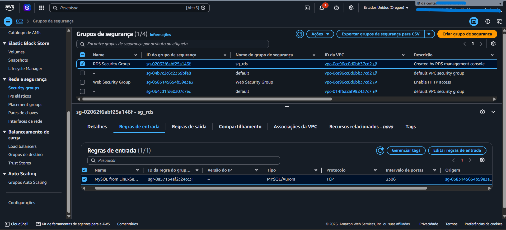
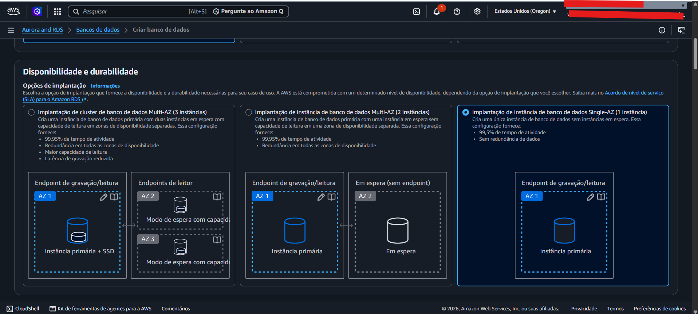
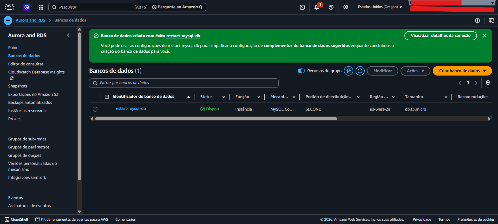
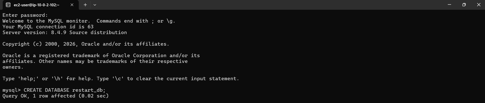
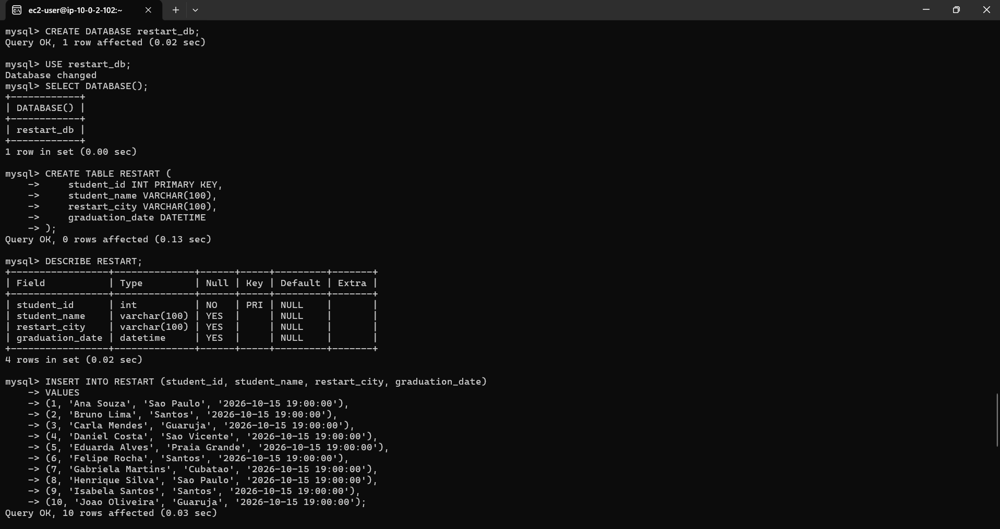
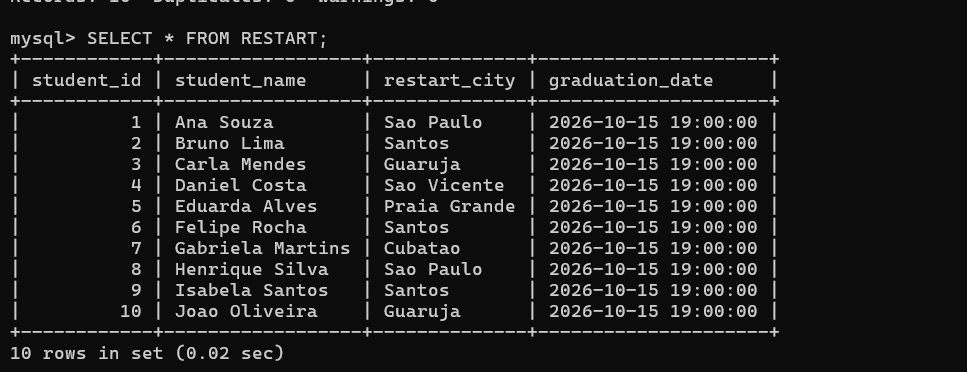
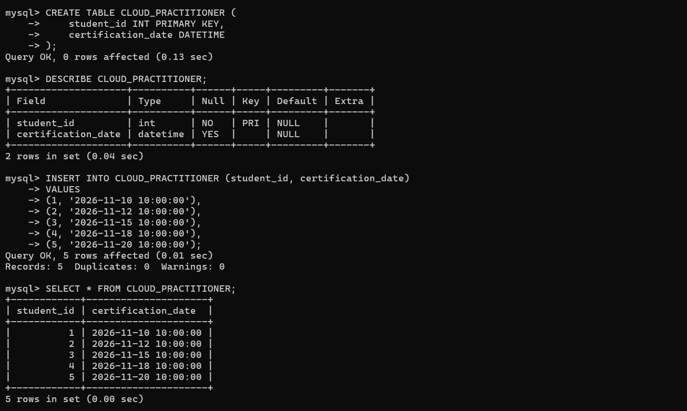
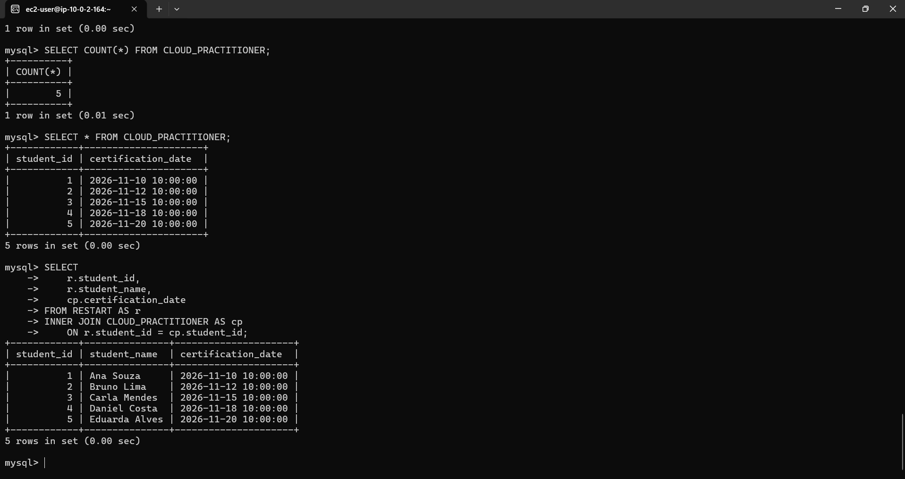

# ☁️ Amazon RDS MySQL Database Lab


Projeto desenvolvido durante o programa **AWS re/Start**, com o objetivo de implementar e acessar um banco de dados relacional gerenciado utilizando o serviço **Amazon RDS for MySQL**.

O ambiente utiliza uma instância Linux como cliente para acessar o banco de dados dentro de uma VPC, o que me permitiu praticar banco de dados relacional, conectividade, segurança de rede e SQL.

> [!IMPORTANT]
> Este projeto foi desenvolvido em um ambiente temporário de laboratório do **AWS re/Start**.
>
> Por esse motivo, endpoints, endereços IP e outros recursos apresentados nas capturas de tela pertencem exclusivamente ao ambiente temporário utilizado durante a atividade e deixam de existir após o encerramento do laboratório.

---

## 📖 Sumário

- [Sobre o Projeto](#ℹ️-sobre-o-projeto)
- [Objetivos](#🎯-objetivos)
- [Arquitetura](#🏗️-arquitetura)
- [Tecnologias e Serviços](#🛠️-tecnologias-e-serviços)
- [Estrutura do Projeto](#📁-estrutura-do-projeto)
- [Implementação](#🚧-implementação)
  - [Provisionamento do Amazon RDS](#1-provisionamento-do-amazon-rds)
  - [Configuração de Rede e Segurança](#2-configuração-de-rede-e-segurança)
  - [Conexão ao Banco de Dados](#3-conexão-ao-banco-de-dados)
  - [Criação e Manipulação dos Dados](#4-criação-e-manipulação-dos-dados)
- [Consultas SQL](#🔍-consultas-sql)
- [Troubleshooting](#🐛-troubleshooting)
- [Aprendizados](#📚-aprendizados)

---

## ℹ️ Sobre o Projeto

O objetivo desse laboratório foi provisionar uma instância de banco de dados **MySQL** usando o serviço **Amazon RDS** e estabelecer uma conexão a partir de uma instância Linux hospedada na AWS.

O laboratório envolve diferentes camadas da infraestrutura:

```text
Computador local
      │
      │ SSH
      ▼
LinuxServer
Amazon EC2
      │
      │ MySQL / TCP 3306
      ▼
Amazon RDS
MySQL
```

Durante a atividade também criei tabelas relacionais, onde foram inseridos dados de exemplo e executadas consultas SQL, incluindo o relacionamento entre duas tabelas utilizando `INNER JOIN`.

> [!NOTE]
> O serviço Amazon RDS é responsável pelo gerenciamento da infraestrutura do banco de dados, enquanto a instância Linux funciona como cliente para estabelecer a conexão e executar os comandos SQL.

---

## 🎯 Objetivos

O laboratório teve como principais objetivos:

- Criar uma instância MySQL usando o Amazon RDS;
- Configurar a conectividade entre uma instância Linux e o banco de dados;
- Controlar o acesso ao banco utilizando Security Groups;
- Acessar o RDS utilizando o cliente MySQL;
- Criar um banco de dados relacional;
- Criar e popular tabelas utilizando SQL;
- Consultar os dados armazenados;

---

## 🏗️ Arquitetura

A solução usa uma instância Linux hospedada no **Amazon EC2** para acessar uma instância **MySQL gerenciada pelo Amazon RDS**.

Os recursos estão dentro da infraestrutura de rede da AWS e a comunicação com o banco ocorre através da porta padrão do MySQL: `3306`.

```text
┌─────────────────────────┐
│    Computador local     │
│     Windows + WSL       │
└────────────┬────────────┘
             │
             │ SSH
             ▼
┌─────────────────────────┐
│      LinuxServer        │
│       Amazon EC2        │
│                         │
│  Web Security Group     │
└────────────┬────────────┘
             │
             │ TCP 3306
             ▼
┌─────────────────────────┐
│       Amazon RDS        │
│         MySQL           │
│                         │
│        sg_rds           │
└─────────────────────────┘
```

> [!IMPORTANT]
> O banco de dados não precisa ficar aberto para toda a internet.
>
> A regra de entrada do Security Group do RDS permite conexões MySQL na porta `3306` usando como origem o **Security Group** associado ao LinuxServer.

Essa configuração permite controlar quais recursos podem iniciar conexões com o banco sem liberar a porta MySQL indiscriminadamente para qualquer endereço IP.

<p align="center">
  
</p>


## 🛠️ Tecnologias e Serviços

| Categoria | Tecnologia / Serviço |
|---|---|
| Cloud Computing | AWS |
| Banco de Dados Gerenciado | Amazon RDS |
| SGBD | MySQL |
| Computação | Amazon EC2 |
| Rede | Amazon VPC |
| Segurança | Security Groups |
| Sistema Operacional | Amazon Linux 2 |
| Acesso Remoto | SSH |
| Cliente de Banco | MySQL Community Client |
| Linguagem | SQL |
| Versionamento | Git / GitHub |


## 📁 Estrutura do Projeto

```text
aws-rds-mysql-database-lab/
│
├── images/
│   ├── 01-rds-single-az.png
│   ├── 02-rds-instance-created.png
│   ├── 03-security-group-RDS-regra-MySQL.png
│   ├── 04-conexao-MySQL-RDS_via_LinuxServer.png
│   ├── 05-estrutura-tabela-RESTART.png
│   ├── 06-select-tabela-RESTART.png
│   ├── 07-estrutura-tabela-CLOUD-PRACTITIONER.png
│   └── 08-inner-join-RESTART.CLOUD-PRACTITIONER.png
│
├── sql/
│   ├── 01_create_tables.sql
│   ├── 02_insert_data.sql
│   └── 03_queries.sql
│
└── README.md
```

> [!TIP]
> Os comandos SQL utilizados durante o laboratório foram separados em arquivos diferentes para facilitar a organização e permitir que as etapas de criação, inserção e consulta possam ser analisadas individualmente.

---

## 🚧 Implementação

### 1. Provisionamento do Amazon RDS

Foi criada uma instância do **Amazon RDS** usando o mecanismo MySQL para hospedar o banco de dados relacional. Para este ambiente de laboratório foi utilizada uma implantação **Single-AZ**, com uma única instância de banco de dados.

<p align="center">
  
</p>

<br>

Após a configuração, a instância foi provisionada pelo Amazon RDS e disponibilizada para conexão através de seu endpoint.

<p align="center">
  
</p>

> [!NOTE]
> Uma implantação **Single-AZ** mantém apenas uma instância principal neste laboratório.
>
> Em cenários que exigem maior disponibilidade, o Amazon RDS também oferece configurações Multi-AZ.

---

### 2. Configuração de Rede e Segurança

Após a criação do banco, foi necessário permitir a comunicação entre o **LinuxServer** e o **Amazon RDS**. Então para  isso, configurei uma regra de entrada no Security Group associado ao banco.

### Regra utilizada

| Configuração | Valor |
|---|---|
| Tipo | MySQL/Aurora |
| Protocolo | TCP |
| Porta | 3306 |
| Origem | Security Group do LinuxServer |

<p align="center">
  
</p>

> [!IMPORTANT]
> Em vez de configurar `0.0.0.0/0` como origem, a regra utiliza outro **Security Group**.
>
> Dessa forma, a permissão é associada ao recurso que precisa se comunicar com o banco, evitando deixar a porta `3306` aberta para qualquer origem.

---

## 3. Conexão ao Banco de Dados

O acesso ao banco foi realizado através do **LinuxServer** fornecido pelo ambiente do laboratório.

Primeiro, foi necessário acessar a instância Linux através de SSH:

```bash
ssh -i labuser.pem ec2-user@<LINUX_SERVER_IP>
```

> [!WARNING]
> O arquivo `.pem` é uma chave privada utilizada para autenticação SSH e **não deve ser enviado para repositórios públicos**.
>
> Antes da conexão, também é importante garantir que o arquivo tenha permissões adequadas:
>
> ```bash
> chmod 400 labuser.pem
> ```

### Instalação do cliente MySQL

Para acessar o banco pelo terminal, foi instalado o **MySQL Community Client**.

```bash
sudo yum install https://dev.mysql.com/get/mysql80-community-release-el7-11.noarch.rpm -y
```

Em seguida:

```bash
sudo yum install mysql-community-client -y
```

A instalação pode ser verificada com:

```bash
mysql --version
```

### Conexão com o RDS

Com o cliente instalado, a conexão foi realizada utilizando o endpoint disponibilizado pelo Amazon RDS:

```bash
mysql -h <RDS_ENDPOINT> -P 3306 -u admin -p
```

Onde:

| Parâmetro | Função |
|---|---|
| `-h` | Define o hostname/endpoint do banco |
| `-P` | Define a porta utilizada |
| `-u` | Informa o usuário |
| `-p` | Solicita a senha |

Após informar a senha, o MySQL Monitor foi iniciado, confirmando que a comunicação entre o LinuxServer e o Amazon RDS estava funcionando.

<p align="center">
  
</p>

> [!TIP]
> Uma conexão bem-sucedida confirma várias partes da infraestrutura ao mesmo tempo: resolução do endpoint, comunicação pela rede, regra do Security Group, disponibilidade do RDS e autenticação no MySQL.

---

## 4. Criação e Manipulação dos Dados

Após estabelecer a conexão, foi criado um banco de dados para realização das atividades SQL.

```sql
CREATE DATABASE restart_db;
```

Em seguida:

```sql
USE restart_db;
```

Para confirmar qual banco estava selecionado:

```sql
SELECT DATABASE();
```

---

### 👩‍🎓 Tabela RESTART

A primeira tabela criada foi `RESTART`.

```sql
CREATE TABLE RESTART (
    student_id INT PRIMARY KEY,
    student_name VARCHAR(100),
    restart_city VARCHAR(100),
    graduation_date DATETIME
);
```

A estrutura pode ser verificada utilizando:

```sql
DESCRIBE RESTART;
```

<p align="center">
  
</p>

A tabela contém:

| Coluna | Tipo | Descrição |
|---|---|---|
| `student_id` | INT | Identificador do estudante |
| `student_name` | VARCHAR(100) | Nome do estudante |
| `restart_city` | VARCHAR(100) | Cidade |
| `graduation_date` | DATETIME | Data de formação |

Foram adicionados **10 registros de exemplo** à tabela.

Para visualizar os dados:

```sql
SELECT * FROM RESTART;
```

<p align="center">
  
</p>

---

### ☁️ Tabela CLOUD_PRACTITIONER

A segunda tabela criada foi `CLOUD_PRACTITIONER`.

```sql
CREATE TABLE CLOUD_PRACTITIONER (
    student_id INT PRIMARY KEY,
    certification_date DATETIME
);
```

A estrutura foi verificada através de:

```sql
DESCRIBE CLOUD_PRACTITIONER;
```

<p align="center">
  
</p>

Foram adicionados **5 registros de exemplo**, utilizando IDs de estudantes existentes na tabela `RESTART`.

Os registros podem ser consultados utilizando:

```sql
SELECT * FROM CLOUD_PRACTITIONER;
```

> [!NOTE]
> A coluna `student_id` aparece nas duas tabelas e é utilizada posteriormente para relacionar os registros através de uma operação de `JOIN`.

---

# 🔍 Consultas SQL

Os scripts SQL utilizados no laboratório foram organizados dentro da pasta:

```text
sql/
```

### Organização

| Arquivo | Responsabilidade |
|---|---|
| `01_create_tables.sql` | Criação do banco e das tabelas |
| `02_insert_data.sql` | Inserção dos registros |
| `03_queries.sql` | Consultas e relacionamento dos dados |

---

## INNER JOIN

A etapa final do laboratório consistiu em relacionar as tabelas `RESTART` e `CLOUD_PRACTITIONER`.

A consulta utilizada foi:

```sql
SELECT
    r.student_id,
    r.student_name,
    cp.certification_date
FROM RESTART AS r
INNER JOIN CLOUD_PRACTITIONER AS cp
    ON r.student_id = cp.student_id;
```

O relacionamento ocorre através de:

```sql
r.student_id = cp.student_id
```

O resultado apresenta:

```text
Student ID
Student Name
Certification Date
```

<p align="center">
  
</p>

> [!IMPORTANT]
> O `INNER JOIN` retorna somente registros que possuem correspondência nas **duas tabelas**.
>
> Como `RESTART` possui 10 estudantes e `CLOUD_PRACTITIONER` possui registros para apenas 5 deles, o resultado contém somente esses **5 estudantes correspondentes**.

---

# 🐛 Troubleshooting

Durante a implementação, encontrei um problema ao tentar estabelecer a conexão com o Amazon RDS utilizando inicialmente o cliente MariaDB disponível no ambiente.

A tentativa de conexão retornava:

```text
ERROR 2059 (HY000):
Authentication plugin 'caching_sha2_password' cannot be loaded
```

Inicialmente havia sido instalado:

```bash
sudo yum install mariadb -y
```

Porém, o cliente disponibilizado pelo ambiente era antigo e não possuía o plugin necessário para o método de autenticação utilizado pelo servidor MySQL.

### 🔧 Solução

Foi instalado o repositório do MySQL Community:

```bash
sudo yum install https://dev.mysql.com/get/mysql80-community-release-el7-11.noarch.rpm -y
```

Depois, o cliente MySQL:

```bash
sudo yum install mysql-community-client -y
```

A versão foi conferida utilizando:

```bash
mysql --version
```

Após a instalação do cliente compatível, a conexão foi realizada normalmente.

> [!TIP]
> Esse erro foi especialmente interessante porque, à primeira vista, uma falha de conexão com um RDS poderia indicar problema no Security Group, endpoint, porta ou senha.
>
> Neste caso, porém, a conectividade estava funcionando: o problema estava na **compatibilidade do cliente com o mecanismo de autenticação do servidor**.

---

## 📚 Aprendizados

Este laboratório permitiu praticar conceitos de **Cloud Computing, redes e banco de dados de forma integrada**.

Entre os principais aprendizados:

### ☁️ Amazon RDS

Foi possível entender melhor a diferença entre executar um banco de dados diretamente em uma máquina virtual e utilizar um serviço gerenciado como o Amazon RDS.

### 🔐 Security Groups

A configuração mostrou na prática como controlar a comunicação entre recursos utilizando Security Groups e como um grupo pode ser utilizado como origem de uma regra de outro grupo.

### 🌐 Conectividade

O laboratório ajudou a visualizar que uma conexão com banco de dados na nuvem depende de diferentes componentes funcionando em conjunto.

```text
Cliente MySQL
      │
      ▼
LinuxServer / EC2
      │
      ▼
Security Groups
      │
      ▼
VPC
      │
      ▼
Amazon RDS
      │
      ▼
MySQL
```

> [!NOTE]
> Um dos principais aprendizados do laboratório foi perceber que trabalhar com banco de dados na nuvem vai muito além de escrever SQL.
>
> Para que uma simples consulta funcione, é necessário entender como **computação, rede, segurança, autenticação e banco de dados** se conectam dentro da arquitetura.

### 🗄️ SQL e bancos relacionais

Também foram praticados:

- criação de banco de dados;
- criação de tabelas;
- definição de tipos de dados;
- utilização de chave primária;
- inserção de registros;
- consultas utilizando `SELECT`;
- inspeção de estruturas utilizando `DESCRIBE`;
- relacionamento entre tabelas;
- utilização de `INNER JOIN`.

---

> [!IMPORTANT]
> Esse projeto foi desenvolvido com fins educacionais e de portfólio durante o programa **AWS re/Start**, como parte dos meus estudos em **Cloud Computing, AWS e engenharia de dados**.

<p align="center">
  
  <br>
</p>